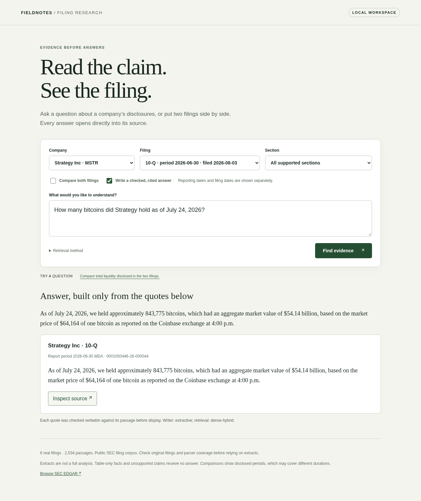

# Filing research: answers from SEC filings that quote the source or abstain

[](https://github.com/RahilBhavan/filing-research-assistant/actions/workflows/ci.yml) [](LICENSE)



*Local app with no API key: the model-free extractive writer produced this answer.*

Filing research answers questions about six SEC filings from Strategy (MSTR), BitMine (BMNR) and Coinbase (COIN). It retrieves five passages from one filing and asks an LLM to answer with exact quotes from them. A deterministic checker turns any answer with a non-verbatim quote or an unquoted number into an abstention. The earlier v2 tool, which calls no LLM, answers over four Docusign and Albany filings with extractive passages.

## Results

Held-out v3 results: 40 questions, 30 answerable and 10 unanswerable, frozen before any writer ran ([report](evaluation/treasury/REPORT.md)).

| Writer | Correct (judge) | Unanswerable abstained | False abstentions | p50 latency | Cost per question |
|---|---|---|---|---|---|
| Claude Haiku 5.5, through the Claude Code CLI | 26/30 | 10/10 | 4/30 | 2.31 s | ≈$0.0003 at API list price |
| Extractive fallback, no model | 16/30 | 7/10 | 6/30 | <0.1 s | $0 |
| qwen2.5:0.5b, local through Ollama | 7/30 | 10/10 | 22/30 | 1.15 s | $0 |

- Every served quote is verbatim, because the checker runs before display. Haiku's misses and abstentions are listed in the report.
- bge-small embeddings fused with BM25 put a gold passage first for 27/30 answerable questions (MRR@5 0.900); BM25 alone did so for 23/30 (`evaluation/treasury/heldout-retrieval.json`).
- Claude Sonnet judged the served answers and agreed with the author labels on 57 of 58 items.
- The v2 tool (no LLM) returned complete gold evidence for 18/20 answerable questions, abstained on 10/10 unsupported ones and quoted 24/24 excerpts exactly. The author had already seen these questions, so it is not a blind benchmark (`evaluation/real/heldout-v2-results.json`).

The Claude Code agent that built the system also wrote the questions, gold passages and labels. No human reviewed them.

### Human-graded check on a fresh set: pending

**The human grade is pending until Rahil fills in the grading sheet.** No human has judged any answer from this set yet.

A fresh held-out set for the v2 tool (Docusign and Albany filings) has 30 questions, 20 answerable and 10 unsupported. The agent wrote the questions, gold answers and exact source passages before running the system, and froze them with a timestamp and SHA-256 hashes (`evaluation/human-grade-v3/frozen.json`, frozen 2026-10-26 01:35 UTC). It shares no question with the dev or heldout sets. The name "v3" here is separate from the treasury v3 above.

Automatic metrics only, BM25 default, one run (`evaluation/human-grade-v3/outputs.json`). They compare cited passage IDs with the agent's gold and do not judge correctness:

| Automatic measure | Result |
|---|---|
| Answerable questions where the gold passage was cited | 2/20 |
| Answerable questions answered from a different passage | 1/20 |
| Answerable questions refused (false abstentions) | 17/20 |
| Unsupported questions refused | 9/10 |
| Unsupported questions answered anyway | 1/10 |
| Excerpts that match their source passage exactly | 4/4 |

Compare the v2 rerun above (18/20 gold-complete, 0 false abstentions on its own questions). The gates were tuned to those 60 questions, and on unseen questions the tool refuses most answerable ones. This was measured once and nothing was changed after seeing it.

To grade, open `evaluation/human-grade-v3/grading-sheet.html` in a browser (or edit `grading-sheet.csv`), fill `rahil_grade` with correct, partial, wrong, correct-refusal or wrong-refusal, then score it:

```sh
python3 -m filing_assistant.human_grade score --sheet grading-sheet-completed.csv
```

This writes `evaluation/human-grade-v3/human-report.md`. See [`evaluation/HUMAN-REVIEW.md`](evaluation/HUMAN-REVIEW.md).

## How it works

1. The question names one ticker and one filing accession.
2. `cited.py` ranks that filing's narrative passages. By default it fuses bge-small-en-v1.5 embeddings (`dense.py`) with BM25 (`retrieval.py`) by reciprocal-rank fusion and keeps the top 5.
3. One writer from `providers.py` sees only those 5 passages: `anthropic` (default `claude-haiku-5-5`), `claude-cli`, `ollama` or `extractive` (the default without `ANTHROPIC_API_KEY`). It returns one sentence of at most 40 words with exact quotes, or abstains.
4. `cited.check` accepts the answer only if every cited passage was retrieved, every quote is a substring of its passage and every multi-digit number in the sentence appears in a quote.

`webapp.py` serves this flow at `/api/answer` and the model-free v2 flow at `/api/ask`.

## Run it

You need Python 3.9 or newer. CI tests 3.9 and 3.12 with the standard library alone, and 3.12 and 3.14 with the locked `embed` extra (fastembed, the default v3 retrieval), which runs the real bge-small model. The `llm` extra (anthropic) adds the Anthropic writer.

```sh
python3 -m venv .venv && .venv/bin/pip install -c requirements-lock.txt -e ".[embed,llm]"
python3 -m unittest discover -s tests -q
```

`requirements-lock.txt` pins the versions used on Python 3.14.7. The suite ran 129 tests, all passing; without the extras, 2 real-model tests skip. No API key is needed.

Ask one question. This uses the extractive writer unless `ANTHROPIC_API_KEY` is set, which the Anthropic writer bills. The first dense retrieval downloads the bge-small model; for a fully offline path, add `--method bm25`.

```sh
.venv/bin/python -m filing_assistant --corpus corpora/treasury answer \
	"How many bitcoins did Strategy hold as of July 24, 2026?" --company MSTR --accession 0001050446-26-000044
```

Serve the web app at `http://127.0.0.1:8765` and tick **Write a checked, cited answer** for the v3 flow. `docker build -t filing-research .` builds the container.

```sh
.venv/bin/python -m filing_assistant --corpus corpora/treasury serve
```

Without `--corpus`, `serve` opens the v2 corpus. Run the CLI from a checkout, because the corpora are not in the installed package.

Retrieval and v2 evaluation runs are deterministic and leave tracked files unchanged unless you pass `--write`. `generate` calls the writer you name; `judge` calls Claude Sonnet through a logged-in Claude Code CLI.

```sh
.venv/bin/python -m filing_assistant.treasury_eval retrieval --split heldout
.venv/bin/python -m filing_assistant.treasury_eval generate --run my-run --provider extractive   # or anthropic, claude-cli, ollama
.venv/bin/python -m filing_assistant.treasury_eval score --run my-run   # after `judge --run my-run`
python3 -m filing_assistant.real_eval heldout-v2
```

## Repository layout

- `filing_assistant/`: parser, retrievers, writers, checker, evaluation runners, web server and `static/` interface.
- `corpora/`: `treasury/` is the v3 corpus (six filings, index, dense vectors, LSA model); `sec/` is v2 (four filings).
- `data/`: fictional fixtures for regression tests.
- `evaluation/`: frozen questions, runs and reports (`treasury/` is v3, `real/` is v2, `human-grade-v3/` is the fresh set awaiting a human grade).
- `tests/`: unit tests (`unittest`).
- `work/`: scripts that wrote questions and built reports (`author_human_grade_v3.py` wrote the fresh set).
- `baselines/`: the first engine, preserved.
- `docs/`: deployment notes, the screenshot and `history/` (September 2026 plans, validation record, walkthrough).
- `.github/workflows/`: CI (lint, tests, embed tests, container) and a manual SEC refresh.

## Documentation

- [`docs/DEPLOY-AZURE.md`](docs/DEPLOY-AZURE.md): untested Azure Container Apps steps and cost.
- [`evaluation/treasury/REPORT.md`](evaluation/treasury/REPORT.md): v3 metrics, every Haiku miss and abstention, other failures.
- [`evaluation/real/REPORT.md`](evaluation/real/REPORT.md): v2 protocol, results and failures.
- [`evaluation/HUMAN-REVIEW.md`](evaluation/HUMAN-REVIEW.md): the independent citation review, not yet done, and how to grade the fresh set.
- [`docs/history/`](docs/history/): historical September 2026 plans, the v2 validation record and the fixture-engine walkthrough.
- [`CONTRIBUTING.md`](CONTRIBUTING.md): local checks and corpus-change rules.
- [`SECURITY.md`](SECURITY.md): what the server checks and where not to run it.

## Sources

All filings come from SEC EDGAR.

- v3: a 10-K and a 10-Q each for Strategy, BitMine and Coinbase, filed 2025-11-21 to 2026-08-03. Original HTTP bytes as of 2026-10-21, pinned by SHA-256 in `corpora/treasury/data/manifest.json`; 2,534 passages.
- v2: a 10-K and a 10-Q each for Docusign and Albany, filed 2026-02-27 to 2026-09-04. Browser DOM captures hashed in `corpora/sec/data/manifest.json`; 1,309 passages, 20 checked against the rendered pages with all matching.
- Only Business, MD&A and Risk Factors are indexed. Tables are excluded.

## Scope and limits

- Independent portfolio project, not affiliated with any company named here or Anthropic.
- The v3 evaluation is small: 40 held-out questions, one run per writer. One question moves a rate by about 3 points.
- The agent that built the system wrote all questions, gold passages and labels. No human has reviewed them; the human-graded check on the fresh set is pending.
- The Haiku run used the Claude Code CLI because no API key was available. The `anthropic` provider is covered by unit tests only.
- The checker verifies quotes and digits, not entities, counts written as words or relevance. A verbatim quote can still give a wrong answer.
- v2 is a known-test rerun with regex evidence gates tuned to its 60 questions. The v1 held-out result cannot be reproduced.
- Not deployed. The container builds and runs locally; the Azure steps have not been run.
- Not investment advice. Facts only in tables or notes are out of scope.

## License

MIT for the code; see [`LICENSE`](LICENSE). SEC filing text under `corpora/` is public-record EDGAR material and is not covered by the license.

Part of [Rahil Bhavan's projects](https://github.com/RahilBhavan).
